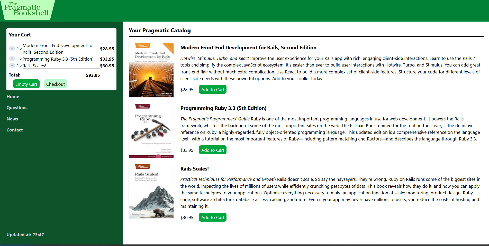

# Depot – Rails 8 E-Commerce Store (Learning Project)

An e-commerce bookstore application built while working through **Agile Web Development with Rails 8** (The Pragmatic Bookshelf). 

While the book uses Minitest, this repository adapts the test suite to use **RSpec**, **FactoryBot**, and **Capybara** system specs.



## What I Practiced in This Project

* **Hotwire & Turbo Streams:** Updating the sidebar shopping cart dynamically (adding items, decreasing quantities, emptying the cart) without full page reloads, plus CSS highlight animations on updated line items.
* **Action Cable & Turbo Morphing:** Broadcasting live product catalog updates (`store/products`) to connected browsers whenever an admin edits a book.
* **Stimulus:** Dynamically toggling payment form fields (Credit Card, Check, Purchase Order) during checkout using `payment_controller.js`.
* **Rails 8 Native Authentication:** Session-based authentication (`has_secure_password`, `Current` attributes, signed cookies, and password reset tokens) to protect admin views (`/admin`, `/products`, `/orders`, `/users`).
* **Background Jobs & Mailers:** Processing order payments asynchronously via **Active Job** (`ChargeOrderJob`) and sending order confirmation emails with **Action Mailer** (previewed locally via `letter_opener`).
* **Fragment Caching:** Caching the storefront catalog and individual product partials (`store/index.html.erb`).
* **Testing with RSpec:** Writing model specs, request specs (including Turbo Stream assertions), mailer specs, and end-to-end headless Chrome system specs (`spec/system/orders_spec.rb`).

## Tech Stack

* **Ruby:** 3.4.5
* **Framework:** Ruby on Rails 8.0.4 (Solid Cable, Solid Cache, Solid Queue)
* **Database:** SQLite3
* **Frontend:** Hotwire (Turbo & Stimulus), Tailwind CSS, Propshaft, Importmaps
* **Testing & Linting:** RSpec, FactoryBot, Capybara, Selenium WebDriver, RuboCop, Brakeman

## Getting Started

### Prerequisites

* Ruby `3.4.5`
* SQLite3
* Bundler

### Setup & Run

**1. Clone the repository:**

```bash
git clone git@github.com:romanpelekh136/depot-rails-app.git
cd depot-rails-app
```

**2. Install dependencies:**

```bash
bundle install
```

**3. Prepare and seed the database:**

```bash
bin/rails db:prepare
bin/rails db:seed
```

**4. Start the development server (Rails + Tailwind CSS watcher):**

```bash
bin/dev
```

Open `localhost:3000` in your browser.

### Admin Access

If you used the seeded admin account from `db/seeds.rb`, you can sign in at `localhost:3000/session/new` to view `/admin`, `/products`, and `/orders`:

* **Email:** `admin@example.com`
* **Password:** `password123`

## Running Tests

```bash
# Run the RSpec test suite
bundle exec rspec

# Run RuboCop linter
bin/rubocop

# Run Brakeman security check
bin/brakeman
```